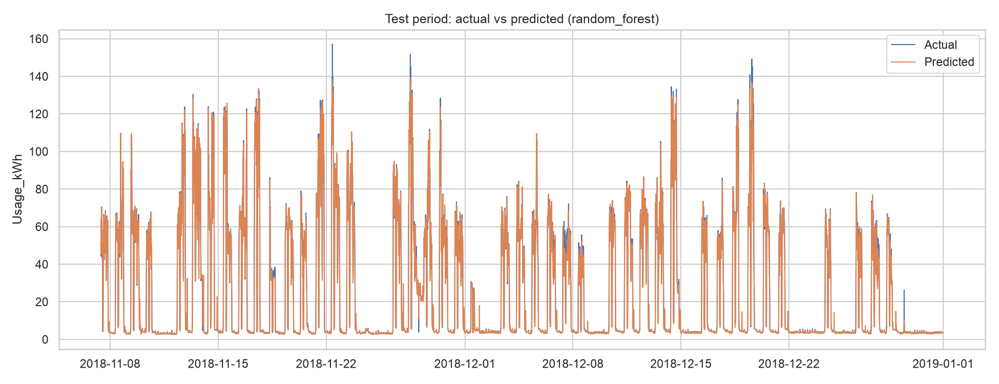
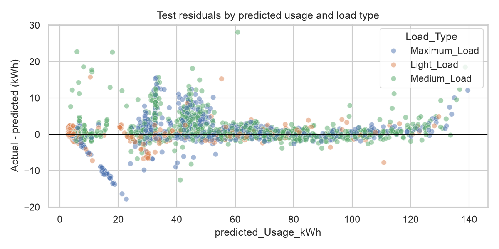

# Experiment 6: Model Evaluation

- **Selected model:** `random_forest` (v6).
- **Selection rule:** validation RMSE; test data remained held out until final evaluation.
- **Test period:** 2018-11-07 09:30:00 through 2018-12-31 23:45:00.
- **Evaluation scope:** rolling one-step forecasts; each row can use previously measured Usage_kWh, including earlier test-period readings. These metrics do not measure recursive multi-step accuracy.

## Test metrics

| Model | MAE | MSE | RMSE | MAPE (%) on nonzero actuals | R2 |
| --- | ---: | ---: | ---: | ---: | ---: |
| persistence_baseline | 5.056 | 135.832 | 11.655 | 20.11 | 0.860 |
| random_forest | 1.031 | 5.646 | 2.376 | 8.06 | 0.994 |
| xgboost | 0.966 | 3.184 | 1.784 | 7.50 | 0.997 |

## Error analysis

The residual plot uses actual minus predicted kWh; positive residuals indicate under-prediction. The worst-25 CSV supports follow-up by timestamp and load type. Review subgroup bias and peaks before deployment; do not remove outliers solely to improve aggregate metrics.

Per-load-type error summary: `{'Light_Load': {'rows': 2835, 'MAE': 0.369, 'bias': 0.04}, 'Maximum_Load': {'rows': 1032, 'MAE': 2.071, 'bias': 0.393}, 'Medium_Load': {'rows': 1375, 'MAE': 1.615, 'bias': 1.117}}`.

## Final model rationale

`random_forest` had the lowest validation RMSE among the tuned tree models. XGBoost achieved a lower RMSE than Random Forest on this particular test period, but the test set was not used to change the validation-selected model; this difference supports collecting another out-of-time validation period. The persistence baseline and all models are reported on the held-out test period. Production rollout should be conditional on the plant confirming sensor availability and acceptable operational error limits.
